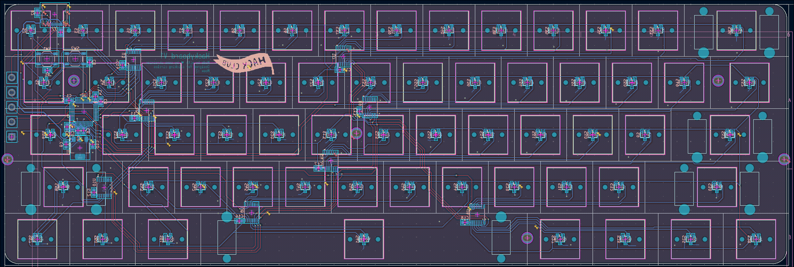
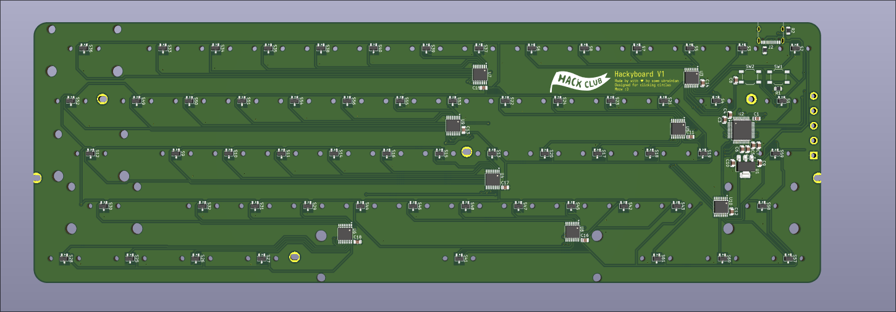
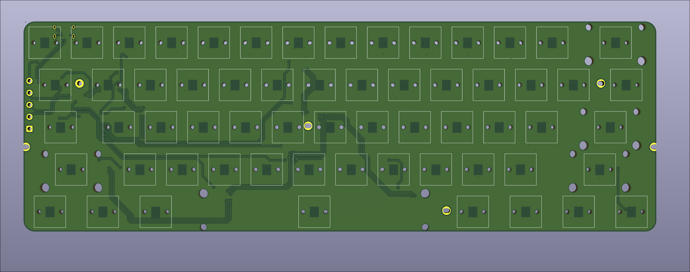
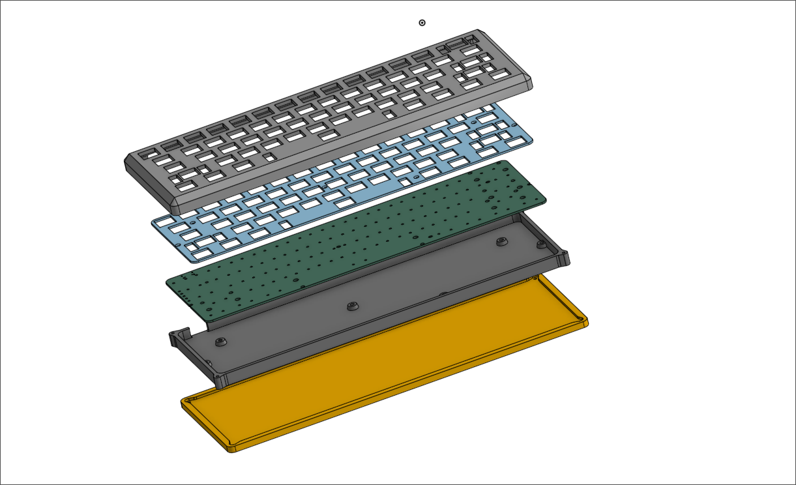

# Hackyboard!
## Overview
They main reason of why this was made is the fact that i play osu. My laptop's keyboard probably doesn't like being smashed at the rate of 12cps so one day i thought that it would be nice to have something to click on.

 I also thought that i should make a keyboard just because i can(and for various other reasons). Routing was kinda time consuming and i tried to minimize the interference between traces. 

I will update this and share the result once i build it!

## PCB
`pcb/`
The PCB was designed in KiCAD 10.

- The PCB is designed for Cherry magnetic switches. 
- The sensors' measurement range is ~82.5mT.
- The MCU that's used is STM32G431CBT6

## CASE
`case/`
The case was designet in oneshape.

- Fits with the pcb (wow)
- Looks simple

It's nothing very special actually. Bottom part, pcb and switch plate are sandwiched together and then it is sandwiched again with (another) bottom and top parts of the case. You can see it on the image on top.

All of the parts except the switch plate are designed to be 3d printed. The switch plate should be machined with cnc from 1.5 allu plate.

> [!NOTE]
> The switch plate can be cut with lser instead but then you will have to use diffrent kind od screws

About screws, the case should be assembled using M2 screws along with M2 heat inserts. Female to female spacers are required in between pcb and switch plate.
## FIRMWARE
./firmware
The firmware is [libhmk](https://github.com/peppapighs/libhmk)
by peppapighs, which is licensed under GPL-3.0. Changes and additions in
`firmware/` (including the MCU support) will be therefore also
released under GPL-3.0, see `firmware/LICENSE`.
*For now it just is. I didn't test it yet*

