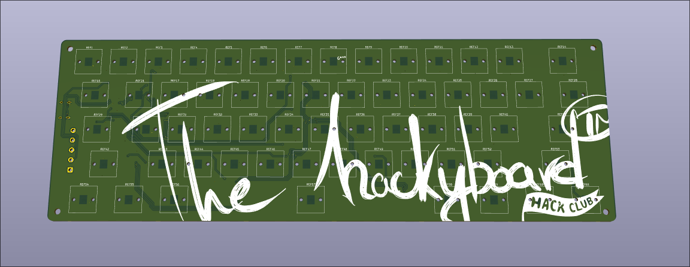
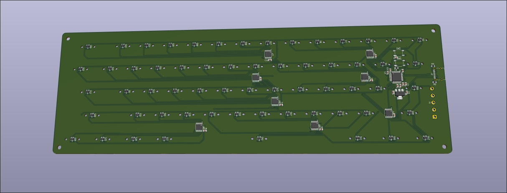

# Hackyboard!
## Overview
They main reason of why this was made is the fact that i play osu. My laptop's keyboard probably doesn't like being smashed at the rate of 12cps so one day i thought that it would be nice to have something to click on. I also thought that i should make a keyboard just because i can(and for various other reasons). I will be honest, it lacks some polish but it's good enough. I will update this and share the result once i build it!
## PCB
`pcb/`
The PCB was designed in KiCAD 10.

- The PCB is designed for Cherry MX magnetic switches. 
- The sensors' measurement range is ~82.5mT.
- The MCU that's used is STM32G431CBT6

All of the components are avaible on LCSC:
| Description | Quantity | Unit Price ($) | LCSC# | Product Link |
| --- | --- | --- | --- | --- |
| 100nF ±10% 50V Ceramic Capacitor X7R 0805 | 40 | 0.0191 | C49678 | [Link](https://www.lcsc.com/product-detail/C49678.html) |
| 1uF ±10% 50V Ceramic Capacitor X7R 0805 | 30 | 0.0403 | C28323 | [Link](https://www.lcsc.com/product-detail/C28323.html) |
| 4.7uF ±10% 25V Ceramic Capacitor X5R 0805 | 40 | 0.0348 | C1779 | [Link](https://www.lcsc.com/product-detail/C1779.html) |
| USB-C (USB TYPE-C) Receptacle Connector 16 Position Surface Mount | 5 | 0.1729 | C165948 | [Link](https://www.lcsc.com/product-detail/C165948.html) |
| 10kΩ ±1% 125mW 0805 Thick Film Resistor | 100 | 0.0034 | C2907219 | [Link](https://www.lcsc.com/product-detail/C2907219.html) |
| 5.1kΩ ±1% 125mW 0805 Thick Film Resistor | 100 | 0.0056 | C27834 | [Link](https://www.lcsc.com/product-detail/C27834.html) |
| SOT-23-3L Linear, Compass (ICs) | 65 | 0.1332 | C52993621 | [Link](https://www.lcsc.com/product-detail/C52993621.html) |
| Tactile Switch SPST 250gf 1.5mm SMD (SMT) Tab 5.2mm x 5.2mm Surface Mount | 40 | 0.0099 | C29780122 | [Link](https://www.lcsc.com/product-detail/C29780122.html) |
| 3.3V Positive Fixed SOT-223 Voltage Regulators - Linear, Low Drop Out (LDO) Regulators RoHS | 1 | 0.8178 | C500795 | [Link](https://www.lcsc.com/product-detail/C500795.html) |
| ARM Cortex-M4F 32 Bit 170MHz LQFP-48(7x7) Microcontrollers RoHS | 1 | 5.0690 | C529355 | [Link](https://www.lcsc.com/product-detail/C529355.html) |
| IC SWITCH 8:1 350Ω TSSOP-16 | 10 | 0.1317 | C19723805 | [Link](https://www.lcsc.com/product-detail/C19723805.html) |
## FIRMWARE
./firmware
The firmware is [libhmk](https://github.com/peppapighs/libhmk)
by peppapighs, which is licensed under GPL-3.0. Changes and additions in
`firmware/` (including the MCU support) will be therefore also
released under GPL-3.0, see `firmware/LICENSE`.
*For now it just is. I didn't test it yet*

